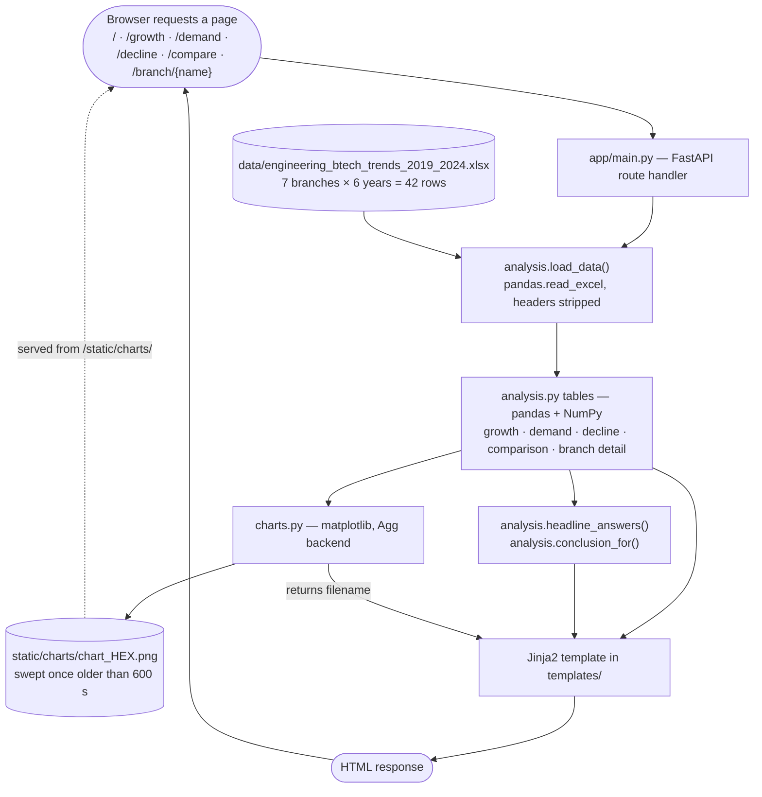

# SIC_PU_June2025

Coursework, problem-solving exercises and project work from the **Samsung
Innovation Campus** *Coding & Programming in Python* programme (June 2025).

The repository holds two kinds of material, and the distinction matters when
deciding what to run:

- **Learning exercises** — 107 self-contained Python scripts under
  [`coursework/`](coursework) and [`problem_solving/`](problem_solving). Each one
  runs on its own from the console; most prompt for input.
- **A standalone application** — [Engineering Branch Trends](projects/engineering_trends),
  a FastAPI web app that analyses six years of B.Tech enrollment and placement
  data, plus a smaller FastAPI CRUD service in the database coursework.

## Table of contents

- [Project overview](#project-overview)
- [What is inside](#what-is-inside)
- [Technology stack](#technology-stack)
- [Repository structure](#repository-structure)
- [The main project: Engineering Branch Trends](#the-main-project-engineering-branch-trends)
- [Prerequisites and installation](#prerequisites-and-installation)
- [Running the components](#running-the-components)
- [Configuration and environment variables](#configuration-and-environment-variables)
- [Tests](#tests)
- [Usage examples](#usage-examples)
- [Troubleshooting](#troubleshooting)
- [Author and license](#author-and-license)

## Project overview

The programme ran from Python fundamentals through to a final project, and the
directory numbering follows that order:

| Area | Directory | What it is |
|---|---|---|
| Python fundamentals | `coursework/01_python_basics` | Conditionals, loops, pattern printing, digit and series problems, lists, recursion, list-backed stacks and queues |
| Data structures and algorithms | `coursework/02_dsa` | Linked-list stacks and queues, binary search, five sorting algorithms, BST and AVL trees with console menus |
| Data analytics | `coursework/03_data_analytics` | NumPy, pandas, Matplotlib, lambda expressions and regular expressions |
| Databases and APIs | `coursework/04_databases_and_apis` | MySQL CRUD over `pymysql`, a FastAPI REST service, an OpenWeatherMap client |
| Independent problems | `problem_solving` | Algorithm problems solved outside the taught exercises, including a `trees/` subfolder |
| Final project | `projects/engineering_trends` | The web application the earlier topics build up to |
| Written work | `docs` | Written Q&A answers and the git workflow assignment |

The coursework is where each technique is learned in isolation; the project is
where pandas, NumPy, Matplotlib, FastAPI and Jinja2 are combined into one
application with its own test suite.

## What is inside

### Python fundamentals — `coursework/01_python_basics` (32 scripts)

Grade classification, leap-year and perfect-square checks, multiplication
tables; digit problems (biggest digit, second-smallest digit, prime-digit
counting, sum of even digits in odd positions); an income-tax calculator and a
farm-revenue calculation; an *n*-th Fibonacci term and prime ranges; six console
patterns (triangles, hollow square, hollow rhombus, X shapes); recursion
(factorial, Fibonacci series, sum of a list); and stacks and queues built on
plain Python lists, inserting at front and at rear.

### Data structures and algorithms — `coursework/02_dsa` (15 scripts)

Stacks and queues implemented on singly and doubly linked lists; binary search
in both iterative and recursive form; bubble, insertion, merge, quick and
selection sort; and BST and AVL trees, each split into the data structure
(`bst.py`, `avl.py`) and a console menu that drives it (`bst_menu.py`,
`avl_menu.py`) with insert, delete, search and the three traversals.

### Data analytics — `coursework/03_data_analytics` (38 scripts)

- `numpy/` — array creation, reshaping, indexing, broadcasting and matrix maths
  across ten graded exercises, plus array normalization, weekly maximum
  spending, and mean/median/mode (mode via `scipy.stats`, since NumPy has none).
- `pandas/` — reading a CSV and summarising it, two ways of iterating rows
  (`iterrows()` and column Series), and serialising a DataFrame with `to_csv()`.
  The CSV lives at `coursework/03_data_analytics/pandas/data/data.csv`.
- `matplotlib/` — eight chart types: line, bar, pie, scatter, 3D scatter,
  histogram, heatmap, and a combined box-and-violin plot. These open a plot
  window via `plt.show()`.
- `lambda_functions/` — ten exercises pairing lambdas with `map`, `filter`,
  `reduce` and `sort`; one also uses `asyncio` and one builds a small `tkinter`
  window.
- `regex/` — digit extraction, removal of non-alphabetic characters, and the
  core `re` operations.

### Databases and APIs — `coursework/04_databases_and_apis` (5 scripts)

- `mysql_employee_crud/` — an employee table in MySQL. `employee_dao.py` holds
  the SQL and the connection handling; `employee_menu.py` is the console menu
  that calls it, printing results through `tabulate`.
- `person_api/` — a FastAPI CRUD service over a MySQL `persons` table.
  `person_dao.py` holds the SQL; `main.py` defines the routes and uses Pydantic
  models so invalid input is rejected with a 422 rather than failing in MySQL.
  The table is created on application startup.
- `weather_client/` — fetches current conditions for a city from the
  OpenWeatherMap API and prints temperature, humidity and wind speed.

### Independent problem solving — `problem_solving` (17 scripts)

Eleven standalone problems, including infix-to-postfix conversion by the
shunting-yard algorithm, N-Queens by backtracking, a florist minimum-cost greedy
problem, server memory balancing and array transport. The `trees/` subfolder adds
six more: binary tree height, mirror checks on BSTs, and AVL insertion, deletion
and rotation tracing (which prints which of LL, RR, LR or RL each rebalance
triggered).

### Written work — `docs`

- `python_and_git_qa.md` — four written answers: what happens when two commits
  are pushed, why Python has no `++`/`--`, IEEE 754 floating-point storage, and
  which module various built-in functions come from.
- `git_workflow_assignment/` — the push and pull demonstration, with the two demo
  text files and two screenshots.

## Technology stack

Core technologies, each verified against the code that uses it:

| Technology | Actual purpose in this repository |
|---|---|
| Python 3.12 | The language throughout; the test suite was run on 3.12.10 |
| pandas | Reads the project spreadsheet and the coursework CSV; all grouping, pivoting and per-branch tables |
| NumPy | Array exercises in the coursework; percentage and rounding arithmetic in the project's analysis |
| Matplotlib | The eight coursework chart exercises, and every chart the web app renders (Agg backend, saved as PNG) |
| openpyxl | The engine pandas needs to read the project's `.xlsx` dataset |
| FastAPI | The web layer of both applications |
| Uvicorn | The ASGI server both applications are launched with |
| Jinja2 | HTML templates for the Engineering Branch Trends pages |
| Pydantic | Request and response models in the Person CRUD API (installed with FastAPI) |
| pytest | The 37 tests covering the Engineering Branch Trends project |
| httpx | Required by FastAPI's `TestClient`, which the web tests use |

Component-specific dependencies, needed only for the database and API coursework:

| Technology | Actual purpose in this repository |
|---|---|
| pymysql | The MySQL driver behind both the employee CRUD and the Person API |
| python-dotenv | Loads `coursework/04_databases_and_apis/.env` in the three scripts that need credentials |
| requests | The HTTP call to OpenWeatherMap in `weather_report.py` |
| tabulate | Renders the employee table in the console menu |
| scipy | Only `scipy.stats.mode`, in `numpy/mean_median_mode.py` |
| tkinter | Standard library; one lambda exercise builds a small GUI window with it |

`seaborn` is listed in the root `requirements.txt` but is not imported by any
script in the repository.

## Repository structure

```text
SIC_PU_June2025/
├── coursework/
│   ├── 01_python_basics/
│   │   ├── conditionals/            7 control-flow exercises
│   │   ├── lists/                   duplicates, frequency, min and max
│   │   ├── number_problems/         digit, series and calculator problems
│   │   ├── patterns/                6 console pattern printers
│   │   ├── recursion/               factorial, Fibonacci, list sum
│   │   └── stack_queue/             stack and queue on plain lists
│   ├── 02_dsa/
│   │   ├── linked_lists/            stack and queue, singly and doubly linked
│   │   ├── searching/               binary search, iterative and recursive
│   │   ├── sorting/                 bubble, insertion, merge, quick, selection
│   │   └── trees/                   bst.py, avl.py + their console menus
│   ├── 03_data_analytics/
│   │   ├── lambda_functions/        10 lambda exercises
│   │   ├── matplotlib/              8 chart types
│   │   ├── numpy/                   13 array and statistics exercises
│   │   ├── pandas/                  CSV loading and row iteration
│   │   │   └── data/data.csv        the sample CSV those scripts read
│   │   └── regex/                   extraction and substitution
│   └── 04_databases_and_apis/
│       ├── .env.example             credential template - copy to .env
│       ├── mysql_employee_crud/     employee_dao.py + employee_menu.py
│       ├── person_api/              main.py + person_dao.py (FastAPI + MySQL)
│       └── weather_client/          weather_report.py (OpenWeatherMap)
├── problem_solving/                 11 standalone problems
│   └── trees/                       6 BST and AVL problems
├── projects/
│   └── engineering_trends/          the main project
│       ├── app/
│       │   ├── analysis.py          pandas + NumPy: every calculation
│       │   ├── charts.py            Matplotlib: every figure, saved as PNG
│       │   └── main.py              FastAPI: one route per question
│       ├── data/                    engineering_btech_trends_2019_2024.xlsx
│       ├── static/style.css         the only stylesheet; charts/ is generated
│       ├── templates/               base.html + one template per page type
│       ├── tests/                   test_analysis.py, test_web.py
│       ├── requirements.txt         what this project alone needs
│       └── README.md                the project's own documentation
├── docs/
│   ├── python_and_git_qa.md         written answers
│   └── git_workflow_assignment/     push and pull demonstration
├── requirements.txt                 everything the repository needs
└── .gitignore
```

## The main project: Engineering Branch Trends

A FastAPI web application that turns one spreadsheet into answers about which
engineering branches are growing, which are in demand, and which are declining.
It has its own [README](projects/engineering_trends/README.md) with more detail.

### What it analyses

The dataset is a spreadsheet committed to the repository at
`projects/engineering_trends/data/engineering_btech_trends_2019_2024.xlsx`. It is
read fresh on every request; there is no database and nothing is fetched over the
network.

- **42 rows** — 7 branches × 6 years (2019–2024).
- **Branches** — Chemical, Civil, Computer Science, Electrical, Electronics &
  Communication, Information Technology, Mechanical.
- **Columns** — `Year`, `Branch`, `Enrollment`, `Graduates`,
  `Graduation Rate(%)`, `Students Placed`, `Job Placement Rate(%)`.

### How a request flows



The three modules are kept apart on purpose. `analysis.py` returns numbers and
nothing else — no charts, no HTML — so every figure shown on the site can be
tested without starting a server. `charts.py` draws with the Matplotlib `Agg`
backend, which needs no display, writes each PNG under a random filename into
`static/charts/`, and returns just the filename for the template. Those PNGs are
gitignored and swept once they are more than 600 seconds old, rather than cleared
on each request, so a second page load cannot delete an image the first page is
still fetching.

### Pages

| Route | What it shows |
|---|---|
| `/` | The four headline answers as cards, over a growth-against-placement-rate scatter plot |
| `/growth` | Branches ranked by percentage change in enrollment, with a table and a written conclusion |
| `/demand` | Branches ranked by average job placement rate, best and worst years included |
| `/decline` | How many of the five year-on-year comparisons each branch fell in, and its net loss |
| `/compare` | Every branch against every headline metric in one table |
| `/branch/{name}` | One branch year by year; an unknown name returns 404 |

FastAPI also serves its own `/docs`, `/redoc` and `/openapi.json` for this app,
though the application itself returns HTML pages rather than JSON.

### What the data shows

Figures produced by running the analysis against the committed spreadsheet:

| Finding | Branch | Figure |
|---|---|---|
| Grew fastest | Computer Science | +36.9% enrollment |
| Most in demand | Information Technology | 81.2% placed on average |
| Least in demand | Civil | 74.4% placed on average |
| Declined most consistently | Mechanical | fell in all 5 year-on-year comparisons |

Four branches fell in all five comparisons; Mechanical is ranked first because it
lost the most students in absolute terms (−184,926). Demand is measured by
placement *rate*, not by the number of students placed — a large branch places
more people simply by being large.

The two measures disagree, which is the point of putting them on one chart:
Information Technology has the best placement record of any branch while losing
39.2% of its enrollment, the steepest decline in the dataset.

## Prerequisites and installation

- **Python 3.12** — the version the repository was developed and tested on. No
  minimum is pinned in any configuration file.
- **pip** and **Git**.
- **MySQL** — only for `coursework/04_databases_and_apis/mysql_employee_crud`
  and `person_api`. Nothing else in the repository needs a database.
- **An OpenWeatherMap API key** — only for `weather_client`. Free keys are
  available at <https://openweathermap.org/api>.

### 1. Clone and enter the repository

```bash
git clone https://github.com/13SunnySingh12/SIC_PU_June2025.git
cd SIC_PU_June2025
```

### 2. Create a virtual environment

```bash
python -m venv .venv
```

### 3. Activate it

Windows PowerShell:

```powershell
.\.venv\Scripts\Activate.ps1
```

Git Bash, macOS or Linux:

```bash
source .venv/bin/activate
```

Your prompt shows `(.venv)` once it is active; `deactivate` leaves it. `.venv/`
is gitignored, so every machine builds its own.

### 4. Install dependencies

Which file to use depends on what you intend to run:

| You want to run | Install |
|---|---|
| Anything in the repository, including the MySQL and weather scripts | `requirements.txt` from the repository root |
| Only the Engineering Branch Trends app and its tests | `requirements.txt` from `projects/engineering_trends` |

```bash
pip install -r requirements.txt
```

The root file is the superset. The project file exists so the project can be run
standalone, and deliberately omits what it does not need — it has no `pymysql`,
`requests` or `python-dotenv`.

### 5. Configure credentials, if you need them

Only required for the database and API coursework. See
[Configuration and environment variables](#configuration-and-environment-variables).

## Running the components

### Console exercises

Everything under `coursework/` and `problem_solving/` runs directly, from the
repository root, by path:

```bash
python coursework/02_dsa/sorting/merge_sort.py
```

Two things to expect. Most of these scripts **prompt for input** rather than
using a fixed example, so run them interactively. And the eight scripts in
`coursework/03_data_analytics/matplotlib/` call `plt.show()`, which opens a plot
window — they need a desktop session, not a headless terminal.

The tree menus (`bst_menu.py`, `avl_menu.py`) import their sibling module, which
works when the file is run by path as above, because Python puts the script's own
directory on the import path.

### Engineering Branch Trends

Run from inside the project directory, so that `app.main` resolves:

```bash
cd projects/engineering_trends
uvicorn app.main:app --reload
```

Uvicorn reports that it is running on `http://127.0.0.1:8000`. Open
<http://127.0.0.1:8000> for the overview page; the interactive API documentation
is at <http://127.0.0.1:8000/docs>.

### Person CRUD API

Requires a reachable MySQL server and a configured `.env` (see below). Run from
inside `person_api`, because `main.py` imports `person_dao` as a sibling module:

```bash
cd coursework/04_databases_and_apis/person_api
uvicorn main:app --reload
```

The `persons` table is created at startup if it does not exist. Requesting `/`
redirects to <http://127.0.0.1:8000/docs>, where the endpoints can be exercised:
`POST /persons`, `GET /persons`, `GET /persons/{id}`, `PUT /persons/{id}` and
`DELETE /persons/{id}`.

### Employee CRUD console menu

Also requires MySQL and a configured `.env`. The `employees` table is created if
it does not exist, then a menu offers view, insert, update, delete and exit:

```bash
python coursework/04_databases_and_apis/mysql_employee_crud/employee_menu.py
```

### Weather client

Requires `OPENWEATHER_API_KEY`. It prompts for a city name, then prints the
current conditions. Without a key it exits with a message telling you where to
get one:

```bash
python coursework/04_databases_and_apis/weather_client/weather_report.py
```

## Configuration and environment variables

Only three scripts read configuration:
`mysql_employee_crud/employee_dao.py`, `person_api/person_dao.py` and
`weather_client/weather_report.py`. All three load
`coursework/04_databases_and_apis/.env` through `python-dotenv`. Real environment
variables, if already set, take precedence over that file.

Start from the committed template
[`coursework/04_databases_and_apis/.env.example`](coursework/04_databases_and_apis/.env.example):

```bash
cp coursework/04_databases_and_apis/.env.example coursework/04_databases_and_apis/.env
```

Then fill in your own values. `.env` is gitignored — never commit real
credentials.

| Variable | Required for | Default in code if unset |
|---|---|---|
| `MYSQL_HOST` | Employee CRUD, Person API | `localhost` |
| `MYSQL_PORT` | Employee CRUD, Person API | `3306` |
| `MYSQL_USER` | Employee CRUD, Person API | `root` |
| `MYSQL_PASSWORD` | Employee CRUD, Person API | empty string |
| `MYSQL_DATABASE` | Employee CRUD, Person API | `sunny_db` |
| `OPENWEATHER_API_KEY` | Weather client | none — the script exits with an explanation |

The MySQL variables all have fallbacks, so the scripts will attempt a connection
even without a `.env`; on a password-protected server that attempt simply fails.
The database itself must already exist, or `MYSQL_DATABASE` must name one that
does.

The Engineering Branch Trends project needs no configuration at all. Its dataset
is committed alongside it.

## Tests

The only test suite in the repository covers the Engineering Branch Trends
project: **37 tests** across two files.

| File | Covers |
|---|---|
| `tests/test_analysis.py` | Every calculation in `analysis.py`, run against the real spreadsheet: dataset shape, growth percentages, placement-rate ordering, decline counts, per-branch detail, and that the written conclusions name real branches |
| `tests/test_web.py` | Every page: status codes, that each chart a page references is actually fetchable, that the stylesheet is served, that the dashboard shows all four answers, that each branch has a working page, and that an unknown branch is a 404 |

Run them from the project directory:

```bash
cd projects/engineering_trends
pytest
```

Or from the repository root:

```bash
pytest projects/engineering_trends
```

All 37 pass on Python 3.12.10 with the dependencies from the project's
`requirements.txt`. Two deprecation warnings are emitted from Starlette's
`TestClient`; they do not affect the results.

Nothing under `coursework/` or `problem_solving/` has automated tests — those
scripts are verified by running them and reading the output.

## Usage examples

**Sorting an array from the console.** `merge_sort.py` asks for a length, then
the elements:

```text
$ python coursework/02_dsa/sorting/merge_sort.py
Enter the length of array: 6
Enter the elements: 5 2 9 1 7 3
Unsorted array: [5, 2, 9, 1, 7, 3]
Sorted array: [1, 2, 3, 5, 7, 9]
```

**N-Queens.** Enter a board size and every valid arrangement is printed:

```text
$ python problem_solving/n_queens.py
Enter the value of N: 4
Solutions for 4 -Queens Problem:

. Q . .
. . . Q
Q . . .
. . Q .


. . Q .
Q . . .
. . . Q
. Q . .
```

**The web application.** With the server running, `/growth` returns a page
containing the ranked enrollment table, two Matplotlib charts rendered for that
request, and a written conclusion built from the same numbers — currently that
Computer Science grew 36.9% while Information Technology fell 39.2%.

## Troubleshooting

**PowerShell refuses to run the activation script.** Allow local scripts for
your user once:

```powershell
Set-ExecutionPolicy -Scope CurrentUser RemoteSigned
```

Or skip activation entirely and call the interpreter directly, for example
`.\.venv\Scripts\python.exe -m pytest projects/engineering_trends`.

**`ModuleNotFoundError: No module named 'app'`** when starting the web app. You
are not in the project directory. `uvicorn app.main:app` must be run from
`projects/engineering_trends`. The same applies to the Person API, which must be
started from inside `person_api` so that `import person_dao` resolves.

**`ModuleNotFoundError` for pandas, fastapi or similar.** The virtual environment
is not active, or dependencies were not installed into it. Check that your prompt
shows `(.venv)` and re-run the `pip install -r requirements.txt` step.

**Reading the `.xlsx` dataset fails.** `openpyxl` is missing — pandas needs it as
the Excel engine. It is listed in both requirements files.

**`Database Connection Failed` or `DB connection failed`.** The MySQL scripts
print this and continue rather than raising. Check that the server is running,
that the database named by `MYSQL_DATABASE` exists, and that the credentials in
`coursework/04_databases_and_apis/.env` are correct.

**The weather client exits immediately.** `OPENWEATHER_API_KEY` is unset or still
the placeholder from `.env.example`. A `401` response instead means the key is
invalid or revoked.

**A Matplotlib exercise appears to hang.** `plt.show()` is waiting on a plot
window. Close it to let the script finish; in a headless terminal these scripts
cannot display anything.

**A chart is missing from a web page.** Charts are written into
`projects/engineering_trends/static/charts/` at request time and deleted once
older than 600 seconds. Reload the page and it is regenerated.

## Author

Created by **Sunny Singh** ([@13SunnySingh12](https://github.com/13SunnySingh12))
as coursework and project work for the Samsung Innovation Campus *Coding &
Programming in Python* programme, June 2025.
